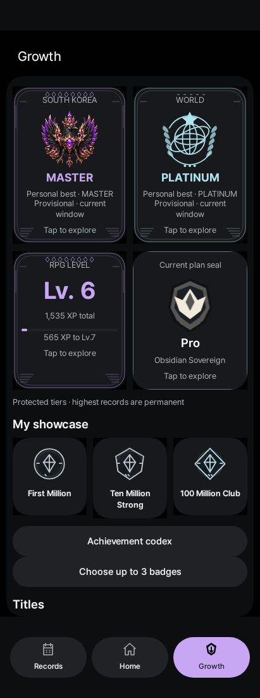
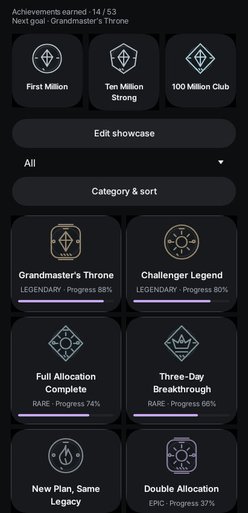
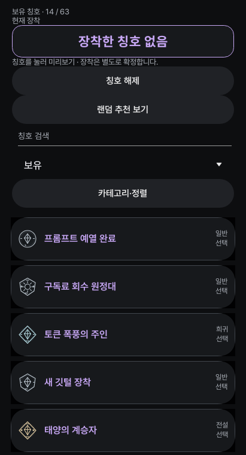

# GPT HUD 한국어판

현재 버전은 **2.8.28 / versionCode 58**입니다. 대표 메달의 이름과 간격, 칭호 글꼴, 업적 소개를 다듬었습니다. 대한민국·홈은 삼족오, 세계 추정 티어는 천구 문장으로 구분하고 한도 상세 사용량 바에도 티어 색상을 연결했습니다. 기존 기록·RPG 성취·소수점 설정은 유지합니다.

[휴대폰 APK](https://github.com/ldjkorea/codex-meter-ko/releases/download/v2.8.28/CodexMeter-2.8.28-ko.apk) · [Windows 위젯 0.1.9](https://github.com/ldjkorea/codex-meter-ko/releases/download/v2.8.27/CodexMeter-WindowsWidget-0.1.9.zip) · [전체 배포 파일](https://github.com/ldjkorea/codex-meter-ko/releases/tag/v2.8.28) · [설치 안내](docs/RPG_UPDATE_INSTALL.ko.md)

소수점 자릿수는 **설정 → 위젯 및 화면 → 사용량 소수점 자리수**에서 바꿉니다. 기존 사용량 기록의 원본 정밀도나 계산은 변경하지 않고 화면 표시만 조정합니다. 기존 휴대폰 앱은 삭제하지 않고 업데이트하세요. Windows 위젯 0.1.9 이상은 위젯 메뉴의 **⋯ → 업데이트 확인**으로 새 버전을 받을 수 있습니다. 최초 설치 또는 0.1.8 이하에서 업데이트할 때는 ZIP을 직접 내려받아 새 폴더에 풀어 실행하세요. 로그인·설정·Tailscale 연결을 보존하려면 기존 AppData 폴더를 삭제하지 마세요.

## 내부 개발: v2.8.29 GROWTH REBORN

공개 버전은 위의 **v2.8.28** 그대로입니다. v2.8.29는 업적·칭호의 독립 시작과 간결한 성장 프로필을 로컬에서 개발·검증하는 내부 버전입니다. 개별 공개 배포는 하지 않습니다. [변경 및 데이터 보존 정책](docs/GROWTH_REBORN_2.8.29.ko.md)을 참고하세요. 다음 정식 배포는 위젯 변경까지 통합 검증한 v2.8.30이며, v2.8.31~49도 내부 개발 후 v2.8.50에서 한 번 통합 배포합니다.

## 앱 화면 미리보기

이번 2.8.28 코드의 Android 에뮬레이터 QA 화면입니다. 분리된 가상 계정으로 촬영했으며 실제 사용자 기록이 아닙니다. 성장·도감은 영어, 칭호 보관함은 한국어 화면입니다.

| 성장 · 대한민국/세계 문장 | 이름과 여백을 정리한 업적 도감 | 칭호 보관함 |
| :---: | :---: | :---: |
|  |  |  |

현재 배포 앱의 대한민국·홈 티어별 삼족오 휘장 자산은 아래 미리보기에서 확인할 수 있습니다.

| Iron | Bronze | Silver | Gold | Platinum |
| :---: | :---: | :---: | :---: | :---: |
|  |  |  |  |  |

| Emerald | Diamond | Master | Grandmaster | Challenger |
| :---: | :---: | :---: | :---: | :---: |
|  |  |  |  |  |

Windows 위젯에 포함된 실제 삼족오 PNG 자산입니다. Android는 같은 티어 순서의 WebP 자산을 사용합니다. 위 이미지는 휘장 미리보기이며 위젯 화면 캡처는 아닙니다.

Codex 사용량을 표시하는 비공식 앱입니다. 원작 [BenItBuhner/Codex-Meter](https://github.com/BenItBuhner/Codex-Meter)의 MIT 라이선스와 저작권을 유지합니다. OpenAI·Samsung·원작자가 제공하거나 보증하는 공식 제품이 아닙니다. [전체 릴리스 기록](RELEASE_NOTES.ko.md)을 보존합니다.

## Windows 바탕화면 위젯

[최신 Windows 위젯 ZIP](https://github.com/ldjkorea/codex-meter-ko/releases/download/v2.8.27/CodexMeter-WindowsWidget-0.1.9.zip)을 받아 압축을 풀고 `CodexMeterWidget.exe`를 실행합니다. 위젯을 이동·크기 조절하고 메뉴에서 항상 위 표시와 투명도를 설정할 수 있습니다. Windows 0.1.9부터는 **⋯ → 업데이트 확인**으로 후속 버전을 확인하고 설치할 수 있습니다. 자세한 절차와 데이터 보존 안내는 [Windows 위젯 README](windows-widget/README.ko.md)를 참고하세요.

## Android 설치

이미 설치한 한국어판은 **기록 → 설정 → 앱 정보 및 라이선스 → 업데이트**에서 새 버전을 확인하세요. 자동 업데이트 확인이 켜져 있으면 기존 검사에서도 2.8.28을 안내합니다. 다운로드·검증 뒤 Android 설치 승인은 직접 눌러야 합니다. 기존 앱을 삭제할 필요는 없습니다.

1. 저장소 **Releases**에서 최신 한국어판을 엽니다. `Source code.zip`은 설치 파일이 아닙니다.
2. 스마트폰에서는 `CodexMeter-<버전>-ko.apk`를 내려받습니다. `CodexMeter-Wear-<버전>-ko.apk`는 Wear OS 시계용입니다.
3. 다운로드 폴더에서 APK를 열고 필요할 때 해당 브라우저/파일 앱의 **이 출처의 앱 설치 허용**을 켭니다.
4. 기존 한국어판과 서명이 같다면 앱을 삭제하지 않고 업데이트합니다. 설치 후 출처 설치 권한을 다시 끌 수 있습니다.
5. 앱 버전, 로그인, 기록, 새로고침을 확인합니다. Android 시스템 언어에 따라 한국어를 적용하며 기본 영어 리소스도 유지합니다.

휴대폰 Android 8.0(API 26) 이상, Wear API 30 이상이 필요합니다. 실제 기기 설치·업데이트·로그인·Samsung AOD/Now Bar·Wear 화면은 이번 공개 준비에서 검증하지 않았습니다.

원본 영문 앱이나 다른 제작자의 같은 패키지 앱은 서명 차이 때문에 덮어쓸 수 없습니다. 패키지 `dev.bennett.codexmeter`를 유지하므로 동시에 설치할 수도 없습니다. 설치 실패 시 앱 제거나 데이터 초기화부터 하지 마세요. 기록 내보내기는 인증·설정·결제정보 전체 백업이 아닙니다. 오류 내용과 설치된 버전을 먼저 확인하세요.

## 기능과 한계

- API가 반환한 5시간·주간·월간 사용량을 표시하고 기록이 충분할 때만 사용 속도와 전망을 계산합니다.
- 한국어 화면, 기록, 티어 배지와 코치 말투를 제공합니다. 티어는 앱 내부의 재미 요소이며 OpenAI 공식 등급이 아닙니다.
- 직접 등록한 결제금액과 기간을 기반으로 구독 활용도 참고값을 표시합니다. API 비용·절약액·생산성 측정값이 아닙니다. 코치 문구에 별도 AI 호출을 사용하지 않습니다.
- 위젯·알림·선택적 사용량 모니터·Wear 연동을 포함합니다. 삼성 전용 화면 동작은 기기와 펌웨어에 따라 달라질 수 있습니다.

소수점 설정은 표시 형식을 선택합니다. 서버가 정수 사용률만 반환하면 잔여량도 `57.00%` 또는 `57.000%`처럼 표시되며, 더 세밀한 사용량을 측정한 뜻은 아닙니다. 서버가 제공하지 않은 소수점 소비량을 추정해서 만들지 않습니다.

## 로그인·개인정보·보안

로그인은 브라우저의 OpenAI 인증 화면을 사용합니다. 인증 토큰은 Android Keystore를 사용하는 AES-GCM 방식으로 기기에 저장됩니다. 사용 기록·결제정보·설정은 기기 내부에 보관됩니다. 내보낸 기록이나 진단 파일은 공유 전에 직접 확인하세요. 공개 이슈에 토큰·계정 식별자·결제정보·원본 로그를 올리지 마세요.

공용 백엔드나 광고·분석 서버는 없습니다. 인증·사용량 및 사용자가 선택한 작업을 위해 OpenAI/ChatGPT에 직접 요청하며 Wear 연동은 Google Play Services를 사용합니다. 2.8.8부터 공개 한국어 저장소의 GitHub 릴리스를 확인합니다. 업데이트 조회·다운로드에는 계정 토큰을 전송하지 않으며 자동 설치하지 않습니다.

ChatGPT 내부 사용량 경로와 삼성 전용 메타데이터는 안정된 제3자 API 계약이 아닙니다. 서비스 변경으로 로그인/조회가 중단될 수 있습니다. 이 저장소는 정식 보안 감사를 통과한 제품이나 상시 지원 서비스를 주장하지 않습니다.

## 업데이트

2.8.7 이하 사용자는 Releases에서 최신 APK를 한 번 수동 설치합니다. 2.8.8 이상은 앱의 **기록 → 설정 → 앱 정보 및 라이선스 → 업데이트**에서 확인할 수 있습니다. 베타 포함 채널과 하루 한 번 자동 확인을 기본으로 하며, 저장한 기존 채널·확인 설정은 유지합니다. 확인된 새 버전은 홈의 업데이트 카드에도 표시합니다. 다운로드 크기·SHA-256·패키지·한국어 인증서·증가한 versionCode를 검사한 뒤 Android 설치 확인을 요청합니다. 자동 확인은 OS의 백그라운드 정책에 따라 늦어질 수 있습니다.

Windows 위젯 0.1.9 이상은 **⋯ → 업데이트 확인**으로 공개 Windows 버전을 확인합니다. 사용자가 확인한 뒤 내려받고 SHA-256과 실행 파일 버전을 검증해 위젯만 교체 실행하며, 로그인·설정·Tailscale 연결 정보는 기존 저장소에서 이어집니다. Android 앱 업데이트와 Windows 위젯 업데이트는 각각 별도로 진행합니다.

정식 versionCode를 증가시키며 기존 한국어 서명 키를 유지합니다. 동일 버전의 공개 APK를 조용히 교체하지 않습니다. [버전·배포 정책](docs/RELEASE_POLICY.ko.md)을 참고하세요.

## 빌드·자동 검증

프로젝트 루트는 `android/`입니다. JDK 21, Android SDK Platform 36 및 37.0, Build Tools 36.0.0이 필요합니다.

```bash
bash android/run-tests.sh
python android/tests/verify-localization.py
python android/tests/verify-publication.py
cd android
bash gradlew :app:assembleRelease :wear:assembleRelease :app:lintRelease :wear:lintRelease --console=plain
```

서명 키 없는 사본은 unsigned Release APK를 만듭니다. 설치용 배포 파일이 아닙니다. `android/build.sh`는 기존 `.local-signing/` 키와 password가 없으면 실패하며 새 키를 만들지 않습니다. 일반 기여자는 한국어 배포 키를 받지 않습니다.

기존 회귀 검사는 필요한 과거 소스를 SHA-256으로 검증하는 fixture로 보관하여 비공개 개발 Git 이력을 공개하지 않아도 실행됩니다. JVM fixture는 실제 기기 렌더링·로그인 검사가 아닙니다.

Actions는 검사·unsigned 컴파일·lint만 실행하며 **서명·태그·Release 게시를 수행하지 않습니다**. `contents: read`, 인증정보 저장 비활성화, Action 커밋 SHA 고정을 적용합니다. 배포 개인키를 Actions에 제공하지 않으며 설치용 APK는 검증한 로컬 빌드만 수동 게시합니다. [빌드·서명 전략](docs/BUILD_SECURITY.ko.md)을 참고하세요.

## 라이선스·지원

원본과 수정 소스의 [MIT LICENSE](LICENSE)를 보존합니다. 포함된 모든 라이브러리·폰트에 MIT가 적용되는 것은 아닙니다. [제3자 고지](THIRD_PARTY_NOTICES.md)에 별도 라이선스와 Pretendard 교체 내역을 적었습니다. 공식 Pretendard 1.3.9의 수정하지 않은 글꼴을 SIL OFL 1.1로 포함하며 APK에도 고지를 동봉합니다.

개인 개발자의 가능한 범위에서 지원합니다. 제보에는 앱/Android 버전, 기기 종류, 민감정보를 가린 재현 절차를 포함하세요. 수정 시점이나 서비스 지속을 보장하지 않습니다. 원본 프로젝트에 한국어 수정본 문제를 대신 접수하지 마세요.

[원본 README](docs/UPSTREAM_README.md) · [출처](docs/SOURCE_PROVENANCE.md) · [한국어 변경사항](RELEASE_NOTES.ko.md)
